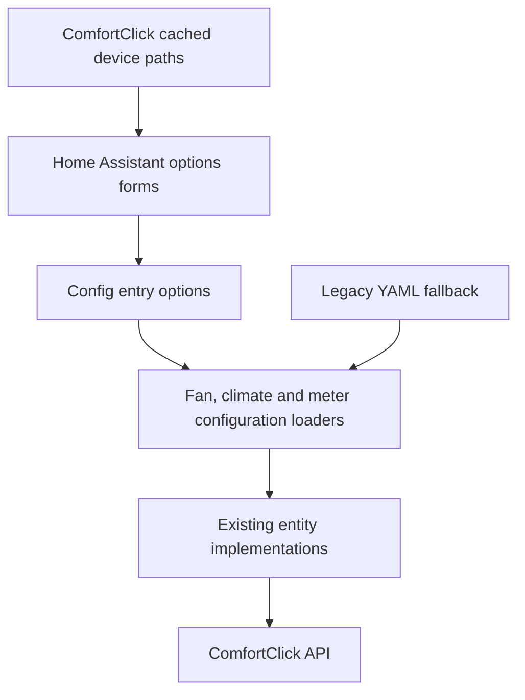

# Mapping configuration

Add native Home Assistant options forms for multiple fans, air conditioners, and
utility meters. Keep transport and device command behavior unchanged.

1. Load each category from entry options when present, otherwise from the existing
   YAML file. An explicit empty list disables that category.
2. Let users add, edit, and remove individual mappings, with cached controller path
   suggestions and manual entry when the controller is unavailable.
3. Preserve imported entity identities and assign an immutable identity to new UI
   mappings, so changing names or paths does not recreate entities.
4. Validate required paths, duplicate mappings, temperature limits, and meter units.
5. Exercise the complete options flows and runtime loading, then run the existing
   suite, lint, and formatting checks before opening a pull request.

The options UI does not send device commands or open additional controller
connections. Locks and ventilation continue to use their existing YAML mappings.
Removing a mapping stops providing its entity; its registry entry and historical
statistics are retained for recovery rather than automatically purged.

Implemented validation includes immutable imported identities, read-only options
wrappers, concurrent category edits, duplicate controller paths, finite temperature
limits, and prevention of water-to-energy conversions under one statistics identity.
The 332-test suite passes on the repository's Home Assistant 2024.11 test runtime,
including real options-flow manager persistence and one reload per successful save.
Ruff lint and formatting checks pass. No live controller commands were used.
