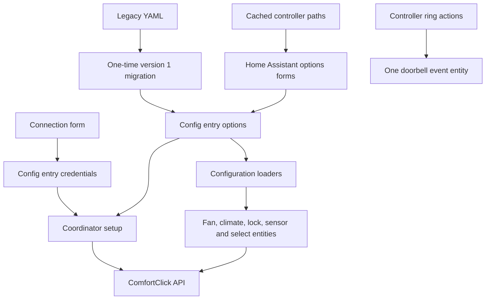

# Mapping configuration

The Home Assistant options flow separates the apartment's fixed equipment
from repeatable room devices. It uses cached controller paths and supports manual
entry while the controller is unavailable. Configuring a mapping does not issue
device commands or open additional controller connections.

| Configuration | Shape | Editable values |
| --- | --- | --- |
| `locks` | Three fixed slots: `main`, `cellar`, `garage` | Controller path |
| `utilities` | Five fixed slots: `electricity_day`, `electricity_night`, `water_cold`, `water_hot`, `heating` | Controller path and compatible native unit |
| `vent` | One shared dictionary | Mode, warm/cold, and air-temperature paths |
| `fans` | Repeatable list | Name, paths, and Home Assistant area |
| `thermostats` | Repeatable list | Name, paths, temperature range/step, and Home Assistant area |
| Doorbell | One automatically created event entity per entry | No mapping form |

Version 2 entries keep every category in config-entry options. Runtime loaders
and mapping forms read these options only. Saving a form writes the corresponding
category and keeps other options intact. New entries start with empty categories.

The version 1 migration reads `comfortclick_custom.yaml` once for categories not
already saved in options. Existing options take precedence, including empty lists
and dictionaries. It computes the complete migration before updating the entry;
malformed legacy configuration leaves its version and options unchanged. Missing
files produce empty categories. After migration the file can be archived or
removed, and later changes to it have no effect.

Connection credentials remain in config-entry data. The Connection form exposes
the controller URL, username, an optional masked password, and certificate
verification. It never pre-fills or returns the saved password; a blank password
retains it. Changed credentials or URL are validated through a separately owned
login/logout client before saving. Validation failures retain the existing
connection, and concurrent connection edits are rejected. TLS-only changes can
still be saved offline. No device commands are sent by these forms.

`fixed_mappings.py` maps legacy door and meter records to semantic slots rather
than list positions. Explicit slot keys take precedence; legacy records are
recognized by their names and meter types. Unknown, ambiguous, duplicate, or
type-incompatible records produce a form error instead of silently disappearing.
Missing slots are included with blank paths. Once saved, the fixed lists contain
exactly three door records and five meter records. Blank paths do not create
entities, and ventilation exposes only controls with their required paths mapped.

Imported `unique_id` values remain unchanged. Legacy mappings without an explicit
identity keep their original path-based identity; new fixed slots use stable
entry-and-slot identities. New fans and thermostats receive immutable generated
IDs. Editing names or paths therefore preserves entity registry references and
history. Fixed meter types cannot be changed in the UI, preventing a water meter's
statistics identity from being reused for energy readings. Unit overrides must
match the controller's raw reading and do not rescale it.

Fan and thermostat forms use Home Assistant's area selector. An existing entity
registry room is suggested for imported mappings without a configured area.
On entity setup, an explicit area is applied after entity registration; an empty
string clears the assignment, while an absent/null legacy value leaves it alone.
Deleted area IDs are ignored rather than overwriting an existing assignment.

Controller paths retain their exact spelling and whitespace. In particular, a
trailing space can be part of a valid ComfortClick identifier. Duplicate detection
normalizes doubled path separators consistently with the API, but does not trim
paths. Form validation also checks required fan/thermostat paths, finite temperature
limits, positive setpoint steps, and compatible meter units.

Only fans and thermostats offer Add/Edit/Remove operations. Removal requires
confirmation. Door and meter slots remain in the catalog when their paths are
cleared; their old entity registry entries and historical statistics are not
automatically purged. The doorbell information page returns to the main menu
without changing configuration.

Saving an operation persists it once, clears the draft, and returns to the main
menu in the same options flow. Done closes the flow without another write.
Changed settings reload the integration through its existing update listener.
For an entry whose setup failed, options are saved before scheduling a retry.
Concurrent edits to the same category are rejected; changes to other categories
are retained. Repeatable device menus bind deterministic opaque action IDs to
immutable mapping IDs rather than list positions. Labels show names and rooms.

The admin-only ComfortClick sidebar page uses the existing options-flow REST
endpoints for all validation and persistence. It adds Back navigation that the
native form dialog does not provide. Back aborts the current flow, creates a new
one, and replays only checked menu choices to reach the parent list. Form inputs
are never replayed, so Back discards unsaved changes without issuing a command or
rewriting settings. The Configuration shortcut returns directly to the root.
Only the JavaScript editor and public strings JSON are served as static assets;
the page has no separate credentials or mapping storage.

Tests cover native options-flow manager routing, read-only options mappings,
persistence and reloads, atomic legacy migration, stable identities, optional and
offline paths, trailing-space identifiers, room assignment, credential masking,
connection validation, removal, and runtime loading without YAML. They use the
repository's real Home Assistant test runtime.

The dependency-free browser regressions live in
`tests/frontend/configuration.test.html`. Serve the repository root with
`python -m http.server 8765`, open that page on localhost, and check its visible
pass/fail list. They exercise invalid-draft Back navigation, removal-menu history,
typed values and exact paths, password masking, and administrator access using
mocked Home Assistant calls; no controller or credentials are required.
