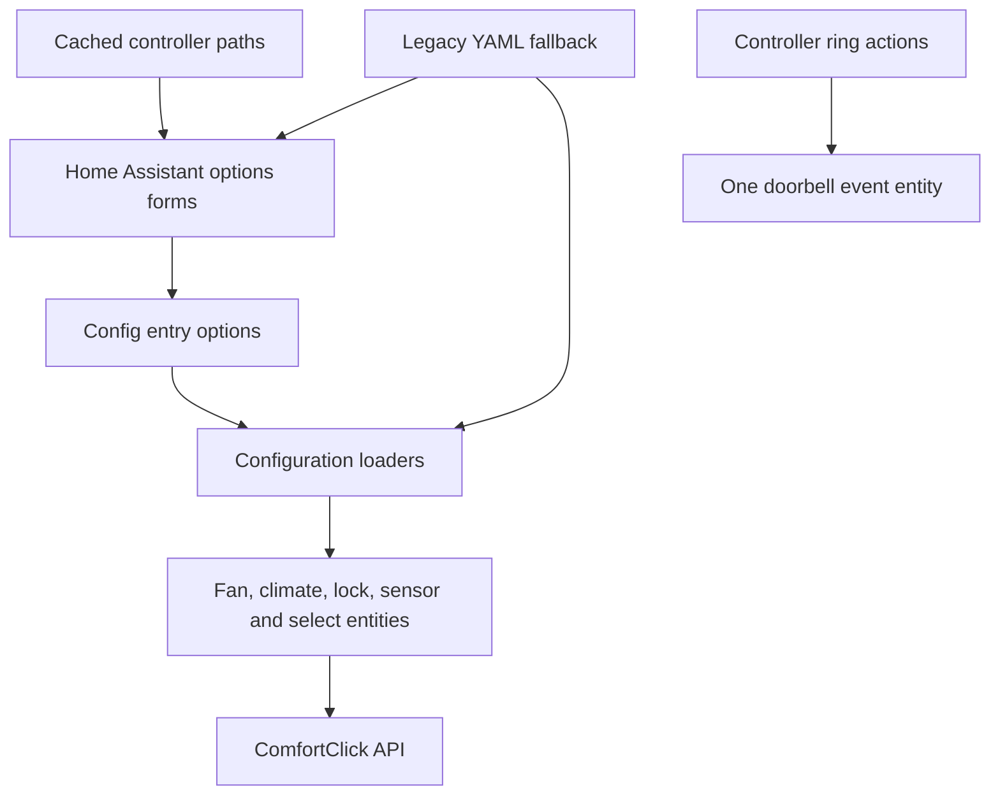

# Mapping configuration

The native Home Assistant options flow separates the apartment's fixed equipment
from repeatable room devices. It uses cached controller paths and supports manual
entry while the controller is unavailable. Configuring a mapping does not issue
device commands or open additional controller connections.

| Configuration | Shape | Editable values |
| --- | --- | --- |
| `locks` | Three fixed slots: `main`, `cellar`, `garage` | Controller path |
| `utilities` | Five fixed slots: `electricity_day`, `electricity_night`, `water_cold`, `water_hot`, `heating` | Controller path and compatible native unit |
| `vent` | One shared dictionary | Mode, warm/cold, and air-temperature paths |
| `fans` | Repeatable list | Name, paths, and Home Assistant area |
| `thermostats` | Repeatable list | Name, paths, temperature range/step, and Home Assistant area |
| Doorbell | One automatically created event entity per entry | No mapping form |

Each category loads from config-entry options when its key is present, otherwise
from `comfortclick_custom.yaml`. Saving a form writes the entire corresponding
category and keeps other options intact. An explicit empty category does not
fall back to YAML. A missing YAML file is supported.

`fixed_mappings.py` maps legacy door and meter records to semantic slots rather
than list positions. Explicit slot keys take precedence; legacy records are
recognized by their names and meter types. Unknown, ambiguous, duplicate, or
type-incompatible records produce a form error instead of silently disappearing.
Missing slots are included with blank paths. Once saved, the fixed lists contain
exactly three door records and five meter records. Blank paths do not create
entities, and ventilation exposes only controls with their required paths mapped.

Imported `unique_id` values remain unchanged. Legacy mappings without an explicit
identity keep their original path-based identity; new fixed slots use stable
entry-and-slot identities. New fans and thermostats receive immutable generated
IDs. Editing names or paths therefore preserves entity registry references and
history. Fixed meter types cannot be changed in the UI, preventing a water meter's
statistics identity from being reused for energy readings. Unit overrides must
match the controller's raw reading and do not rescale it.

Fan and thermostat forms use Home Assistant's area selector. An existing entity
registry room is suggested for imported mappings without a configured area.
On entity setup, an explicit area is applied after entity registration; an empty
string clears the assignment, while an absent/null legacy value leaves it alone.
Deleted area IDs are ignored rather than overwriting an existing assignment.

Controller paths retain their exact spelling and whitespace. In particular, a
trailing space can be part of a valid ComfortClick identifier. Duplicate detection
normalizes doubled path separators consistently with the API, but does not trim
paths. Form validation also checks required fan/thermostat paths, finite temperature
limits, positive setpoint steps, and compatible meter units.

Only fans and thermostats offer Add/Edit/Remove operations. Removal requires
confirmation. Door and meter slots remain in the catalog when their paths are
cleared; their old entity registry entries and historical statistics are not
automatically purged. The doorbell information page returns to the main menu
without changing configuration.

Saving one operation finishes the flow and reloads the integration through its
existing update listener. For an entry whose setup failed, options are saved
before scheduling a retry. Concurrent edits to the same category are rejected;
changes to other categories are retained.

Tests cover native options-flow manager routing, read-only options mappings,
persistence and reloads, semantic legacy imports, stable identities, optional and
offline paths, trailing-space identifiers, room assignment, validation, removal,
and runtime loading. They use the repository's real Home Assistant test runtime.
